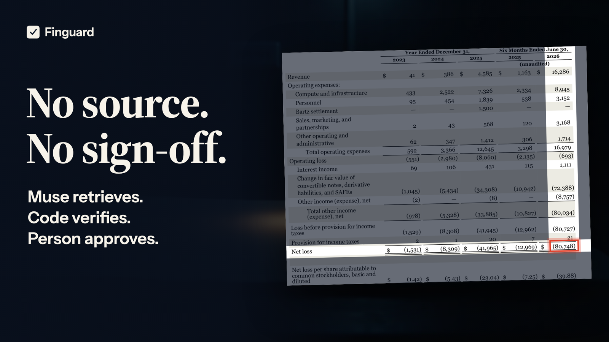
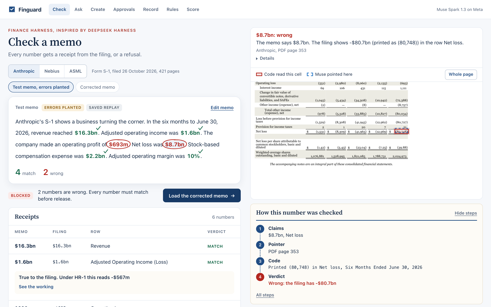
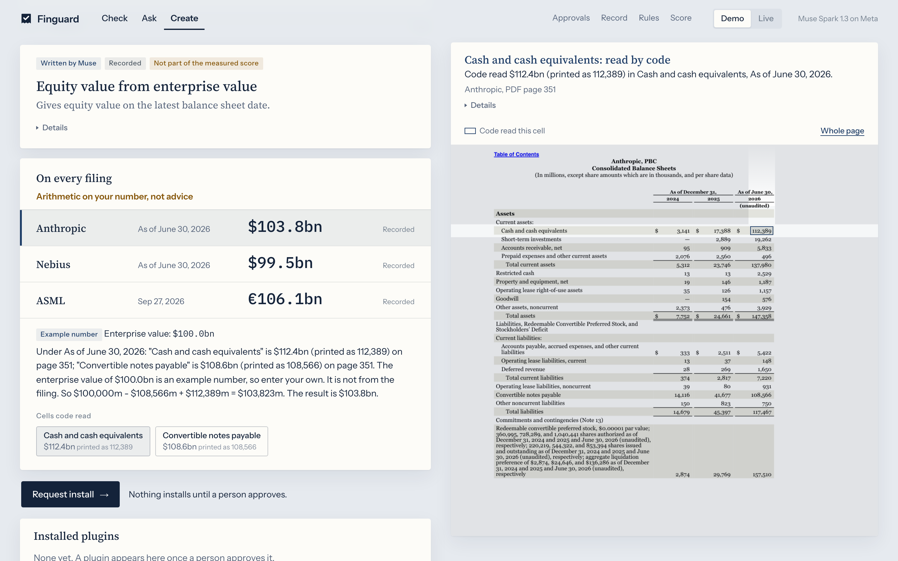

# Finguard



**A finance harness inspired by DeepSeek Harness, running on Muse.**

Finguard checks every number in an investment memo against the filing. A fund then builds its own rules, valuation methods and workflows on top, as plugins. Every plugin states in code whether it reads or acts, who must approve it, and how its result is verified.

**Try it:** https://finguard-157951168487.asia-south1.run.app

**Built with:** We used Muse Wonder and Claude Opus 5.5 to build this. Muse Spark 1.3 runs inside it.



## Try the demo

The switch in the top bar picks the mode. **Demo** replays recorded Muse replies. **Live** calls Muse now, takes about a minute, and allows 5 runs an hour per visitor.

1. **Check** the Anthropic test investment memo. Its errors are planted. Click a red number to see the cell code read and where Muse pointed.
2. **Try to fool it.** Change a number and check again.
3. **Load the corrected investment memo.** All 6 match. Flip to **Our method**, and $1.6bn reads -$567m under the example rule HR-1.
4. **Request release**, then approve it as a demo reviewer.
5. **Ask** "Did Anthropic make money in the first half of 2026?" Every number in the answer is checked. "Add back stock compensation." is refused, with no call to Muse.
6. **Create** a plugin. Pick Equity value and enter an enterprise value. It runs on all three companies.
7. **Rules, Record and Score** show each plugin's rules, the hash-chained ledger and the results.

## How a check works

1. Muse lists the claims in the investment memo. Each must appear word for word.
2. Muse points to where the filing reports each metric, using page images and a 0-1000 box grid. It is never told the investment memo's number.
3. Code reads the PDF's own text at that spot, and checks the row, column, units, currency, sign, period and wording.
4. Each number gets a verdict: match, wrong, refused or not checked.
5. An investment memo can be released only if every number matches and a person approves that exact content. The release is sealed as a bundle of hashes, and every step goes on a hash-chained ledger.

Muse replies in schema-locked JSON. A bad reply can cause a refusal, but only code gives a verdict.

## Build your own plugin (Finance Creator Mode)

**Describe it.** Open **Create** and describe a method that gives one number. Muse writes the idea and maps it to each filing, as data and never as code. Code reads the cells and does the sum, and a person approves the install. It can use one number of yours, and changing that number makes no Muse call.

| Method | Anthropic | Nebius | ASML |
| --- | --- | --- | --- |
| Equity value, at an enterprise value of 100bn | $103.8bn | $99.5bn | €106.1bn |
| Net debt | -$3.8bn | $503.6m | -€6.1bn |
| Free cash flow | $3.4bn | Refused | €10.2bn |
| Gross margin check | Refused | Refused | 55.05% |
| Capex intensity | Refused (a miss) | Refused | 3.75% |

Read by hand, all 10 computed results are right, 4 of the 5 refusals are right, and 1 is a miss. One more method was dropped because Muse mapped it to a false row on ASML and code could not tell. Muse chooses the rows, so read the working. Equity value is arithmetic on your number, not advice.



**Write it.** Copy [`examples/plugins/net_debt.py`](examples/plugins/net_debt.py) into `finguard/plugins/` and restart. The rules sit in the declaration:

```python
def register(registry: Registry) -> None:
    registry.add(Capability(
        name="desk.net_debt",
        summary="Net debt on a balance sheet date, from the filing's own cells.",
        kind="read",
        approval="none",
        verifies="Code reads each printed cell from the named column and does the sum in Decimal. A missing row is refused.",
        params={"type": "object", "additionalProperties": False, "required": ["filing", "page", "as_of"], "properties": {
            "filing": {"type": "string", "maxLength": 64},
            "page": {"type": "integer"},
            "as_of": {"type": "string", "maxLength": 40},
        }},
        run=_net_debt,
    ))
```

```bash
.venv/bin/finguard do desk.net_debt filing=nebius page=5 "as_of=June 30, 2026"
```

A plugin that acts must set `approval="person"`, or the program will not start. [`examples/plugins/memo_pack.py`](examples/plugins/memo_pack.py) is a whole workflow: it checks an investment memo, applies a method and asks for release, then stops until a person approves.

Three ideas come from DeepSeek Harness's public design: everything is a plugin, every model request is on the record, and real replies are saved and replayed. No code is shared.

## Results

Measured on live `muse-spark-1.3`, against values read on the filing pages.

| Test | Altered numbers passed | Invented metrics passed | True numbers matched |
| --- | --- | --- | --- |
| **Final test: Alphabet's Q3 2026 release, first used after the code was frozen** | **0 of 216, and 0 of 428 harder ones** | **0 of 2** | **19 of 25**, 6 refused, 0 called wrong |
| Earlier frozen test: NVIDIA Q1 fiscal 2027 | 0 of 144, and 0 of 20 harder ones | 0 of 2 | 1 of 20, 19 refused, 0 called wrong |
| Older round, no longer fresh because an audit used these filings | 0 of 273, and 0 of 558 harder ones | 0 of 3 | 25 of 31, 6 refused, 0 called wrong |
| Repeat run on the filings used to build it, which flatters the code | 0 of 575, and 0 of 1,295 harder ones | 0 of 5 | 59 of 62, 3 refused, 0 called wrong |

- **Repeat runs.** The final test ran 4 times live and matched 19, 18, 18 and 19. No true number was called wrong and no altered number passed in any run. Muse's replies vary, even at temperature 0.
- **Coverage and risk, first run.** Coverage is 19 of 25, or 76%. Risk is 0 of 19, with a 95% upper bound of 14.6%. False passes are 0 of 644. Those come from 25 numbers on one filing, so counting each once gives a bound of 11.3%.
- **Regressions.** `python eval/gate.py` replays every past round with no key. It fails on any false pass, any true number called wrong, or a drop in matches.
- **Misses.** A person can flag a verdict, and it becomes a case the score replays until the code gets it right. A flag changes no verdict. There are no real cases yet.

The score measures the attacks it lists, on one public filing. It does not cover every possible error. An earlier audit found 20 ways a false number could pass, all now closed with tests. The full history is in [docs/evaluation.md](docs/evaluation.md).

## Limits

- Creator plugins are simple arithmetic: one result, at most one number of yours, and only `+ - * /`. Muse picks the rows and no code checks that choice, so read the working.
- It refuses true numbers: 6 of 25 on the final test.
- HR-1 is an example. A fund's real rules replace it, and a reworded question can get past its refusal.
- It reads numbers in tables only. A number in running prose is refused.
- It checks one filing at a time, and it checks numbers, not the sense of a sentence.
- Fiscal periods are refused when the column is a calendar date that does not end in December.
- Harmless wording can be refused, because the word before a number must plainly state it.
- A live run can differ from a recorded one, because Muse's pointing varies.
- The demo keeps state on one instance. A restart clears its runs and any flags not saved to `eval/misses/`.
- Anyone who can write to the state folder could forge it whole. The ledger catches edits, not that.

**Future enhancements:** several assumptions per method, a code check on Muse's row choice, describing whole workflows in Create, and more held-out filings.

## Run it locally

```bash
uv venv --python 3.12 .venv
uv pip install --python .venv/bin/python -e ".[dev]"
.venv/bin/python -m pytest -q
.venv/bin/python -m uvicorn finguard.web:app --port 8790
```

Open http://localhost:8790. Recorded runs need no key. Live checks need `MODEL_API_KEY`, and approving on the web needs `FINGUARD_OPERATOR_TOKEN`.

Rerun the published score with no API:

```bash
PYTHONPATH=. .venv/bin/python eval/score.py --round final
```

See [docs/architecture.md](docs/architecture.md) for how it is put together.

## How it was built

We used Muse Wonder and Claude Opus 5.5 to build this. Claude Opus 5.5 wrote and reviewed the code. At runtime, Finguard calls one model, Muse Spark 1.3.

All code in this repository is new. The idea, the look and the house rule idea come from [Finrail](https://github.com/0xtigerclaw/finrail), my earlier project, and no Finrail code is used. DeepSeek Harness ([repo](https://github.com/deepseek-ai/deepseek-harness), MIT) inspired the record and replay design. The filings in `data/` are public documents, listed with sources and hashes in `data/sources.json`.

## Licence

Apache 2.0. See [LICENSE](LICENSE).
