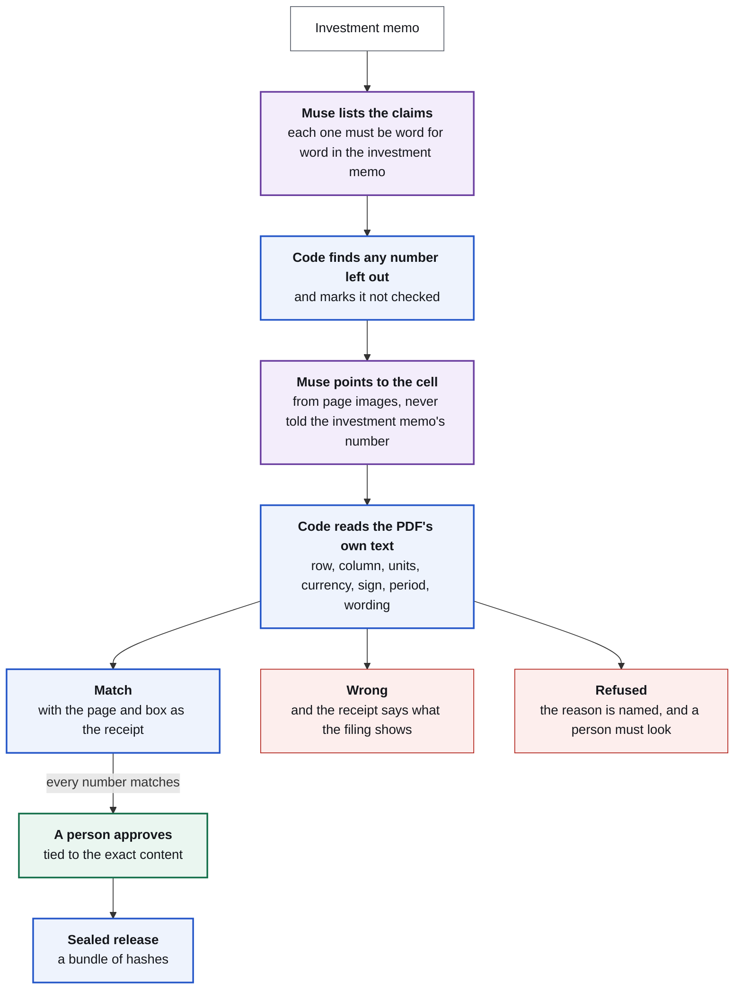
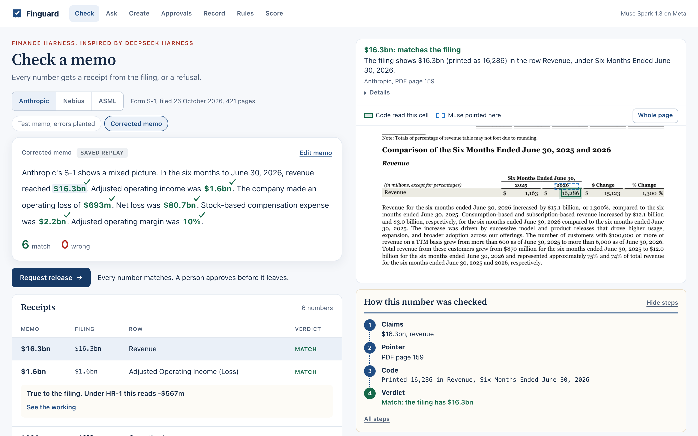
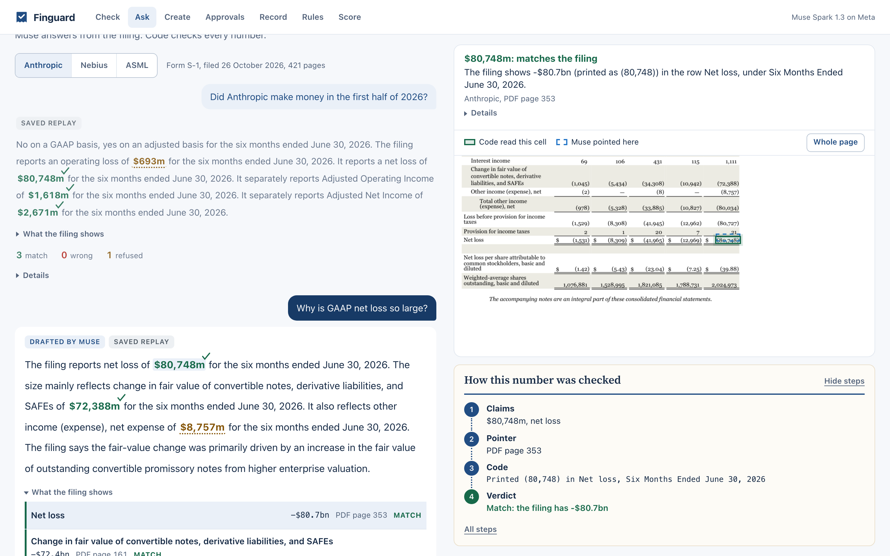
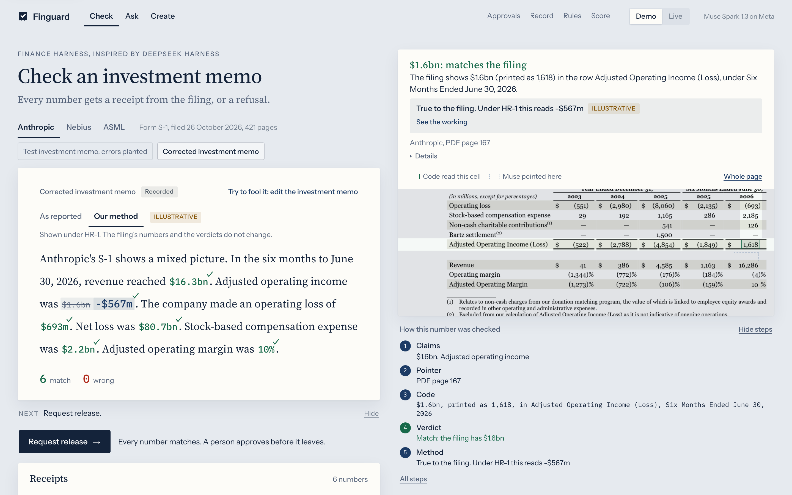
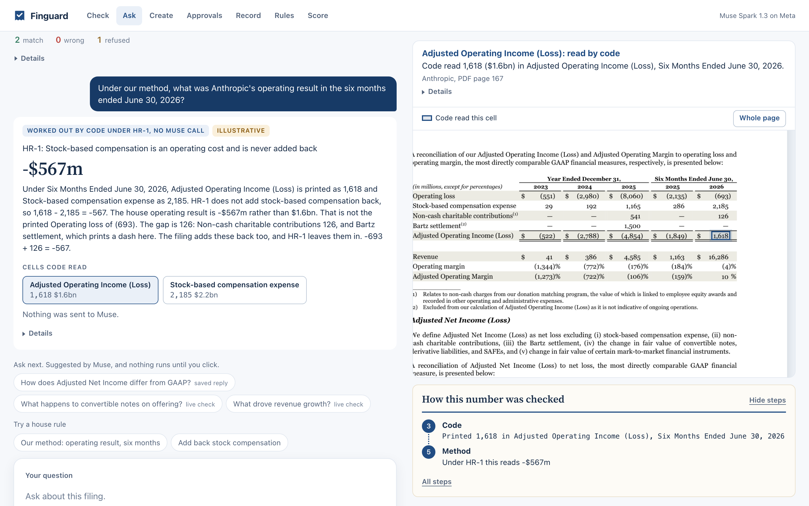
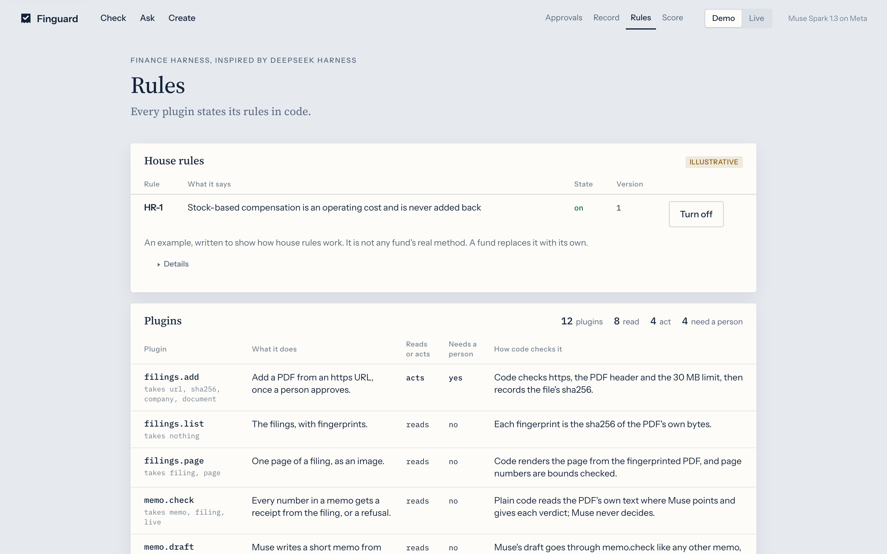
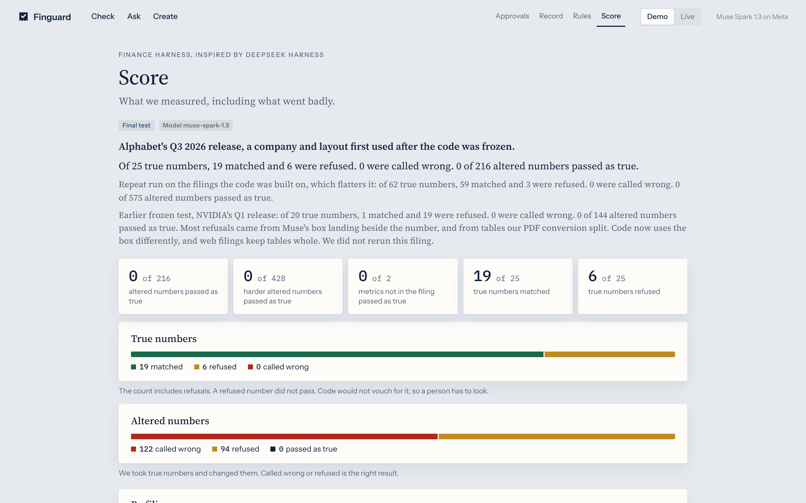

# Finguard


**A finance harness inspired by DeepSeek Harness, running on Meta Muse.**

Finguard makes sure the numbers in an investment memo are right, and that is the floor. Its real potential is what a fund builds on top: its own rules, its valuation methods, the workflows that matter to it.

It is built on the idea at the heart of DeepSeek Harness: everything is a plugin. It adds one rule that finance needs. Every plugin must state, in code, whether it reads or acts, whether a person must approve it, and how its result is verified. A plugin that acts with no approval rule stops the program at start.

The first plugins do the floor's job: every number in an investment memo gets a receipt from the filing, or a refusal. Muse proposes, code verifies, and a person releases. **Then you build yours:** describe a method in a sentence and it runs on every filing, or write one in Python. See [Build your fund's methods](#build-your-funds-methods-as-a-plugin).

**Try it:** https://finguard-157951168487.asia-south1.run.app

**Built with:** We used Meta Wonder and Claude Opus 5.5 to build this. Meta Muse Spark 1.3 runs inside it. See [How it was built](#how-it-was-built).


## Inspired by DeepSeek Harness

Finguard takes three ideas from DeepSeek Harness's public design, and carries each into finance. No code is shared.

| DeepSeek Harness established | Finguard adds, for finance |
| --- | --- |
| **Everything is a plugin.** | Every plugin also declares its trust rules: reads or acts, who must approve, how it is verified. The checks, follow-ups, house rules, releases and Creator Mode all run as plugins through one door. |
| **If the model saw it, it is a record.** | Every Muse request can be rebuilt byte for byte from a hash-chained ledger, and a released investment memo is sealed with its record. |
| **Record and replay.** | Real Muse replies are saved and replayed in tests, so anyone can rerun the published score with no API key. |

DeepSeek Harness is a general agent harness. Finguard is narrower on purpose: one domain, where a fluent wrong number is the most expensive kind.

## Build your fund's methods as a Plugin

A fund's edge is its own methods: how it values a company, which numbers it trusts, what must happen before an investment memo leaves. In Finguard, each one is a plugin, and there are two ways to make one. Both run under the same rules.

| | Describe it | Write it |
| --- | --- | --- |
| **Who** | An analyst, on the Create page | A developer, in Python |
| **What it covers** | A method that gives one number, with at most one number of yours | Anything: a full valuation model, a house metric, a whole workflow |
| **What you give** | A sentence | One file in `finguard/plugins/` |
| **Who writes it** | Muse writes the idea and maps it to each filing, as data, never code | You |
| **What runs it** | Finguard's own code, which reads each cell and does the sum | Your code, with Finguard's filing reader and door |
| **Before it runs** | A person approves the install | It must declare its trust rules, or the program will not start |

Either way, the plugin appears on the Rules page, every run goes on the ledger, and the page and the command line can both call it.

### Describe it

Open **Create**, pick a method or type your own, and press **Write the plugin**. There is no company to pick: one idea runs on every filing, and Muse maps it to each filing's own rows and period. Code reads every cell, and refuses if it cannot find them. These saved examples are real Muse mappings:

| Method | Anthropic | Nebius | ASML |
| --- | --- | --- | --- |
| **Equity value** at an enterprise value of 100bn that you enter | $103.8bn | $99.5bn | €106.1bn |
| **Net debt** | -$3.8bn | $503.6m | -€6.1bn |
| **Free cash flow** | $3.4bn | Refused: it prints purchases combined with intangibles | €10.2bn |
| **Gross margin check** | Refused: no printed margin to compare with | Refused: no printed margin to compare with | 55.05%, tying to the printed 55.0% |
| **Capex intensity** | Refused, and this one is a miss: the filing prints both numbers | Refused: no separate property row | 3.75% |

When a method cannot read what it needs, Finguard refuses and estimates nothing. Read by hand, all 10 computed results are right, 4 of the 5 refusals are right, and 1 is a miss. One more method was dropped from this list because Muse mapped it to a false row on ASML and code could not tell. See [the plugin eval](docs/evaluation.md#the-plugin-eval).

Muse never gives these values, and it is never sent your number, so changing your number recalculates with no Muse call. The result is labelled "Arithmetic on your number, not advice". A formula may hold only input names, plain numbers, `+ - * /` and parentheses, and code parses it itself. Muse decides which rows a method uses, and the working shows them, so read it: for net debt, Anthropic's debt is its convertible notes, ASML's is long-term debt, and short-term investments are not counted as cash. A fund may draw those lines differently. These results are not part of the measured score: 15 results on 3 filings is a small sample.

### Write it

The Python route covers any method. Copy [`examples/plugins/net_debt.py`](examples/plugins/net_debt.py) into `finguard/plugins/` and restart. Any module there with a `register` function loads with no other change. The trust rules sit in the declaration, where anyone can read them:

```python
def register(registry: Registry) -> None:
    registry.add(Capability(
        name="desk.net_debt",
        summary="Net debt on a balance sheet date, from the filing's own cells.",
        kind="read",
        approval="none",
        verifies="Code reads each printed cell from the named column and does the sum in Decimal. A missing row is refused.",
        params={"type": "object", "additionalProperties": False, "required": ["filing", "page", "as_of"], "properties": {
            "filing": {"type": "string", "maxLength": 64},
            "page": {"type": "integer"},
            "as_of": {"type": "string", "maxLength": 40},
        }},
        run=_net_debt,
    ))
```

Run it from the terminal:

```bash
.venv/bin/finguard do desk.net_debt filing=nebius page=5 "as_of=June 30, 2026"
```

That returns `503.6`, with each printed cell it read. A plugin that acts must set `approval="person"` and say what the approval binds to, or the program stops at start with a plain error. `tests/test_example_plugin.py` proves all of this on a real filing. `finguard rules` prints every plugin's rules from the live registry.

**A workflow is a plugin too.** [`examples/plugins/memo_pack.py`](examples/plugins/memo_pack.py) checks an investment memo, applies a named method, and asks for release. Every step goes through the door, and it stops at "needs a person", because nothing in a plugin can approve itself. Muse does not write workflows in Create: a person writes them.

## The problem

Investment memos are now drafted with AI, and they read well whether or not the numbers are right. The dangerous error is not the number that looks wrong. It is the true number from the wrong line, the wrong period or the wrong definition.

**Example 1: three true answers to one question.** Did Anthropic make money? Its S-1 gives three true lines for the same six months:

| Line, six months to June 30, 2026 | Amount |
| --- | ---: |
| Net loss | -$80.7bn |
| Operating loss | -$693m |
| Adjusted operating income, as Anthropic presents it | +$1.6bn |

An investment memo that picks one of these has made a call for the fund, without saying so.

**Example 2: a real number from the wrong quarter.** ASML's filings report these for total net sales:

| Three months ended | Total net sales |
| --- | ---: |
| June 28, 2026 | €9.3bn |
| September 27, 2026 | €11.7bn |

An investment memo saying second quarter sales were €11.7bn quotes a real figure from a real filing. Only a check of the row and the column catches it. Finguard refuses it.

## The approach

Each kind of step goes to the party able to guarantee it:

| Kind | Performed by | Guarantee |
| --- | --- | --- |
| **Code** | The door and the checks | It always runs, or the action does not run. It reads the row, column, units, currency, sign, period and the words around the number. |
| **Judgement** | Muse, called as a function | None, by design. It lists claims and points to cells. Code verifies what it says. |
| **Approval** | A person | Tied to the exact content, and works once. A model cannot give one. |

Which line belongs in the investment memo is the fund's method, and the method is data that code applies. Under the illustrative house rule HR-1, stock compensation is a cost, so the same cells give **-$567m** rather than +$1.6bn. A request to add it back is refused before any Muse call.

## Three design principles

### 1. Muse never decides

Muse proposes where a number is. Code decides whether it is true. A verdict comes only from the PDF's own text and plain rules, so a wrong or hostile reply can cause a refusal, but it cannot write the answer.

### 2. Muse is never told the number

When Muse points to a cell, it gets the metric and the period, and not the investment memo's value. It cannot lean toward the investment memo. If its box picks out no number or several, it gets one second look at an enlarged crop, never more.

### 3. The interface is a plugin

The checks, follow-ups, house rules and Creator Mode all go through one door, and the page and the command line both call it. Neither has authority of its own. In Creator Mode, Muse writes a new plugin as data and never as code, and a person approves the install.

## How an investment memo flows



Purple is judgement, blue is code, green is a person, red is a verdict against the investment memo.

## What to try in the demo

The switch in the top bar picks the mode. **Demo** uses recorded Muse replies, instant and free. **Live** calls Muse now, in about a minute, limited to 5 runs an hour per visitor. Changing only a number stays instant in Demo. Approving needs no token for recorded runs, as a labelled demo reviewer.

1. **Check:** run the Anthropic test investment memo, which has errors planted on purpose. Two numbers get red rings. Pick one to see the cell code read and where Muse pointed.
2. **Try to fool it:** change any number and check again. It is instant, because Muse never saw the number.
3. **Load the corrected investment memo.** All 6 match, and Request release appears.
4. **Ask:** "Did Anthropic make money in the first half of 2026?" Muse writes an answer, and every number is checked like any investment memo. Follow its suggested next questions.
5. **House rule:** on the corrected investment memo, flip **As reported** to **Our method**, and $1.6bn reads -$567m in place. In Ask, the "Our method" chip gives the same -$567m, worked out by code with no Muse call.
6. **Refusal:** the "Add back stock compensation." chip is refused with the rule's text.
7. **Build a method:** in Create, pick Equity value and enter an enterprise value. It runs on all three companies, each with its cells boxed. Approve it as a demo reviewer, and it becomes a plugin you can run.
8. **Rules, Record, Score:** every capability's declared rules, the hash-chained ledger, and the measured results.

## Screens

**Check.** Wrong numbers are ringed. The filing's row and column light up and meet at the cell code read, beside where Muse pointed.


**Corrected.** Every number matches, so the investment memo can go to a person.



**Ask.** A conversation about a filing. Every turn is checked again from scratch.



**House rules.** Flip the method, and the same cell reads differently. The verdict stays true to the filing.





**Create.** Describe a method in a sentence. Muse maps it to each filing, and code reads the cells and does the sum.


**Rules.** Rendered from the live registry.



**Score.** The measured results, including the bad one.



## The plugins

| Plugin | What it does | The rule it enforces |
| --- | --- | --- |
| `memo.check` | Every number in an investment memo gets a receipt | Code gives the verdict from the PDF's text. A number left off Muse's list shows as not checked. |
| `memo.flag` | A person says a verdict is wrong. It becomes a case the score replays | Read: it changes no verdict. The case stays open until a replay gives what the person said |
| `memo.draft` | Muse answers a question from the filing, with follow-ups | Its investment memo is stored exactly as written and checked like any other. Nothing carries over as verified. |
| `memo.release` | Seals a checked investment memo as a bundle of hashes | Refused unless every number matches. A person must approve, and a changed rule needs a new check. |
| `rules.list`, `rules.apply`, `rules.change` | House rules as data | Muse never sees a rule. A change needs a person's approval and goes on the ledger. |
| `plugins.create`, `plugins.install`, `plugins.list`, `custom.*` | Creator Mode | Muse writes data, never code. Code parses the formula itself. Only a definition from a real Muse run can be installed, with approval. |
| `filings.list`, `filings.page`, `filings.add` | The filings | Adding one needs approval. PDF only, with a size limit and a recorded hash. |

## Check it yourself, without a model

The rules hold whether or not Muse behaves. These tests feed the checker the wrong quarter, the wrong currency, a hedged sentence and a moved box, with no key and no network, and each must not pass:

```bash
.venv/bin/python -m pytest tests/test_audit.py tests/test_check.py -q
```

The score reruns from saved Muse replies, with no API:

```bash
PYTHONPATH=. .venv/bin/python eval/score.py --round final
```

## Quickstart

```bash
uv venv --python 3.12 .venv
uv pip install --python .venv/bin/python -e ".[dev]"
.venv/bin/python -m pytest -q
.venv/bin/python -m uvicorn finguard.web:app --port 8790
```

Then open http://localhost:8790. Saved runs need no key. Live checks need `MODEL_API_KEY`, and approving on the web needs `FINGUARD_OPERATOR_TOKEN`. From the terminal:

```bash
.venv/bin/finguard rules
.venv/bin/finguard ledger verify
```

## Engine

Muse Spark 1.3 through the Meta Model API, the only model at runtime. The code uses its image reading, its 0-1000 box grid and its schema-locked JSON replies. Each pointing call sends up to 6 page images, and each draft up to 8.

## Evaluation

Measured on live `muse-spark-1.3`, against printed values read on the filing pages. Read the first row.

| Test | Altered numbers passed | Invented metrics passed | True numbers matched |
| --- | --- | --- | --- |
| **Final test: Alphabet's Q3 2026 release, an issuer and layout first used after the engine was frozen** | **0 of 216, and 0 of 428 harder ones** | **0 of 2** | **19 of 25**, 6 refused, 0 called wrong |
| Earlier frozen test: NVIDIA Q1 fiscal 2027, kept as measured | 0 of 144, and 0 of 20 harder ones | 0 of 2 | 1 of 20, 19 refused, 0 called wrong |
| Older held-out round. No longer a fresh test, because an audit used these filings | 0 of 273, and 0 of 558 harder ones | 0 of 3 | 25 of 31, 6 refused, 0 called wrong |
| Repeat run on the filings used to build it. This flatters the code | 0 of 575, and 0 of 1,295 harder ones | 0 of 5 | 59 of 62, 3 refused, 0 called wrong |

The bad row is why the good one exists. An audit first proved 20 ways a false number could pass, and all are now closed with tests. The NVIDIA test then showed Finguard refusing almost everything, because Muse's box landed beside the number and our PDF conversion split tables. Both were fixed before the final test.

A system allowed to refuse has two numbers. On the final test, **coverage** (how often it answers) is 19 of 25, or 76%. **Risk** (how often an answer is wrong) is 0 of 19, which on a sample this small could still be up to 14.6%. False passes are 0 of 644, with a 95% upper bound of 0.46%. Those 644 all come from 25 numbers on one filing, so the careful bound, counting each of the 25 once, is 11.3%.

**Muse does not repeat itself, even at temperature 0.** The final test was run 4 times live: 19, 18, 18 and 19 matched. 22 of 25 numbers got the same verdict every time, and 17 of 25 matched every time. A number that moved always moved between match and refused. No true number was called wrong, and no altered number passed, in any run.

**Each change is replayed against every past round.** `python eval/gate.py` runs in CI with no key, and fails on any false pass, any true number called wrong, or a drop in matches. It shows the code did not get worse on saved replies, and says nothing about a new filing.

**A miss can become a test.** Flag a verdict, and it becomes a case that replays with no API and stays open until the code gets it right. It changes no verdict by itself. There are no real cases yet.

**Plugins have their own small test,** read by hand: 15 results on 3 filings, all 10 computed results right, and 4 of 5 refusals right. One more method was dropped because Muse mapped it to a false row and code could not tell.

The score measures the attacks it lists, not every possible error, and the final test is one public filing. Every step is in [docs/evaluation.md](docs/evaluation.md).

## Follow-ups and house rules

**Follow-ups.** Muse sees the last 4 turns as data, with what the check found for each number, and offers up to 3 next questions. None runs until a person picks it. A conversation stays on one filing, stops at 8 turns, and comes back after a reload.

**House rules.** The one rule shipped, HR-1, is **illustrative**: "Stock-based compensation is an operating cost and is never added back". On Anthropic's six months, 1,618 - 2,185 = -567. Code then ties it to the table: the printed operating loss of (693) plus 126 of non-cash charitable contributions, which HR-1 leaves in. A house note never changes a verdict, because $1.6bn is true to the filing. The refusal matches question patterns, so a reworded question can get past it, and its numbers are still checked.

## Honest limitations

- **It refuses true numbers:** 6 of 25 on the final test, including "Year To Date" headings it does not read as nine months.
- **HR-1 is illustrative.** A fund's real rules replace it.
- **Fiscal periods are refused** when the column is a calendar date that does not end in December.
- **Tables only, for numbers.** A number in running prose is refused, not read.
- **A live run can differ from a saved one.** Muse's pointing varies, so a number a saved run matched can be refused live. It has not been seen to turn into a wrong match.
- **Muse chooses a plugin method's rows, and no code checks that choice.** Code checks the cells. Read the working.
- **Flags on the deployed site are temporary.** A case is lost at the next deploy unless it is saved into `eval/misses/`.
- **One filing per check.** An investment memo drawing on two filings cannot be checked as one.
- **Wording.** The word before a number must plainly state it, so harmless wording can be refused. It checks numbers, not the sense of a sentence.
- **Shared years.** Where two columns share a year, an investment memo must say which date, or it is refused.
- **The demo keeps state on one instance.** A restart clears its runs. Saved runs replay recorded replies and say so.
- **Forgery.** Anyone who can write to the state folder could forge it whole. The chain catches edits, not that.

## Docs

| | |
| --- | --- |
| [docs/architecture.md](docs/architecture.md) | How it is put together. |
| [docs/evaluation.md](docs/evaluation.md) | Every test, in order, with the classes of altered number. |
| [AGENTS.md](AGENTS.md) | The rules for anyone working in this repo. |

## How it was built

We used Meta Wonder and Claude Opus 5.5 to build this. The code was written and reviewed by Claude Opus 5.5, working as several agents in parallel, with a separate audit agent trying to break the checks. Separately, at runtime, Finguard calls one model as a function: Meta Muse Spark 1.3 lists claims, points to cells, writes drafts and writes plugin definitions.

## A new project

Built during the Meta Global AI Developer Hackathon, and all code in this repository is new. The idea, the look and the house rule idea come from Finrail (github.com/0xtigerclaw/finrail), the owner's earlier project, and no Finrail code is used. DeepSeek Harness (github.com/deepseek-ai/deepseek-harness, MIT) inspired the record and replay design, and no code is shared. The filings in `data/` are public documents, and `data/sources.json` lists each source and hash.

## Licence

Apache 2.0. See [LICENSE](LICENSE).
